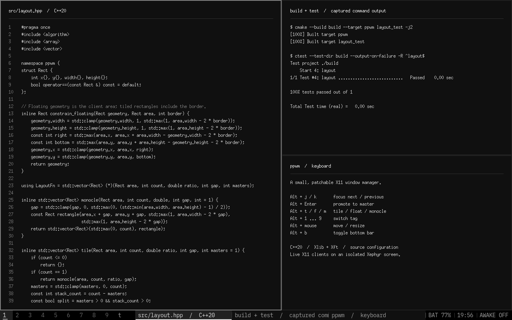

# ppwm

Minimal, patchlenebilir bir C++20 X11 pencere yöneticisi.



Gerçek Xephyr oturumundan alınmıştır; görüntüdeki istemciler demo programına aittir.

- Otomatik master/stack döşeme, floating ve monocle yerleşimleri.
- Birlikte görüntülenebilen dokuz etiket; etiket başına yerleşim, oran, master sayısı ve bar ayarı.
- Pencere gizleme, geçici önizleme, scratchpad ve terminal swallowing.
- Alt ile fareden taşıma/boyutlandırma ve kenarlara yaslama.
- Entegre alt bar: pil, saat, keep-awake durumu ve XEmbed sistem tepsisi.
- Siyah/gri palet, 14 px Lilex Nerd Font Mono, 2 px kenarlık, sıfır boşluk.
- Kaynak dosyalarından değiştirilebilen ayarlar, kısayollar, yerleşimler ve bar modülleri.

Bar, X olaylarından bağımsız **50 ms zamanlayıcıyla** arayüz durumunu kontrol eder; değişmeyen turda çizim yapmaz. Pil/saat gibi durum sağlayıcıları ayrı **2 saniyelik** periyotta okunur. Etiket göstergesi bu yavaş veri periyodunu beklemez. Pencere ve tepsi protokolleri X11 olaylarını işler. İş yokken ana döngü `poll()` içinde bekler.

## Derleme

Linux (`/proc`), C++20 derleyici, CMake 3.20+, pkg-config, Xlib, Xft ve XRes geliştirme dosyaları gerekir.

```sh
cmake -S . -B build -DCMAKE_BUILD_TYPE=Release
cmake --build build -j
ctest --test-dir build --output-on-failure
./build/ppwm --version
```

Release derlemesi, destekleniyorsa LTO kullanır. İsteğe bağlı kullanıcı kurulumu:

```sh
cmake --install build --prefix "$HOME/.local"
```

## Deneme

Xephyr ve xdotool kurulu bir X11 masaüstünde (Xfixes geliştirme dosyaları varsa imleç görüntüsü testi de derlenir):

```sh
python3 scripts/nested-test.py
```

Test, boş bir ekran numarasını otomatik seçer ve ana masaüstünün fare hareketlerini almayan, eşlenmemiş bir üst pencere içinde çalışır. Pencere, klavye/fare, bar, swallowing, tray ve yük testlerini bu ekranda çalıştırır; sonunda kendi süreçlerini kapatır. Test programları yanlışlıkla ana masaüstünde çalıştırılmayı reddeder. Entegrasyon senaryoları varsayılan tuş/fare profilini kullanır; özelleştirilmiş tablolar için `config` testi çakışma ve geçersiz hedef kontrolü sağlar.

Elle incelemek için kullanılmayan bir ekran numarasıyla iki terminal aç:

```sh
Xephyr :98 -screen 1280x800 -ac -nolisten tcp
```

```sh
DISPLAY=:98 ./build/ppwm
```

Xephyr içinde `Alt+a` terminal açar. Ana WM aynı tuşu yakalarsa Xephyr'in klavye yakalamasını kullan (`Ctrl+Shift`). ppwm, başka bir WM'nin yönettiği ekranda başlamaz.

Ayrı bir X oturumunda kullanmak için oturum başlangıcındaki son komut `exec ppwm` olabilir. ppwm oturum başlangıç dosyalarını veya sistem ayarlarını değiştirmez.

## Kısayollar

| Tuş | İşlem |
| --- | --- |
| Alt+a / p | Terminal / dmenu |
| Alt+s / e / n | Tarayıcı / dosya yöneticisi / Neovim |
| Alt+j / k | Sonraki / önceki pencere |
| Alt+l / i | Master oranını 0,03 küçült / büyüt |
| Alt+Enter | Seçili tiled pencereyi master yap |
| Alt+t / f / m | Tile / floating / monocle |
| Alt+Space | Son iki yerleşim arasında geçiş |
| Alt+Sol / Sağ | Master sayısını artır / azalt |
| Alt+Shift+j / k | Gizli pencereleri de içeren geçici önizleme |
| Alt+Shift+Space | Seçili pencerenin floating durumunu değiştir |
| Alt+sol sürükleme | Floating yap ve taşı |
| Alt+sağ sürükleme | Floating yap ve boyutlandır |
| Alt+orta tık | Floating durumunu değiştir |
| Alt+1…9 | Etikete geç |
| Alt+Shift+1…9 | Pencereyi taşı ve yeni etikete geç |
| Alt+Ctrl+1…9 | Görünüme etiket ekle/çıkar |
| Alt+Ctrl+Shift+1…9 | Pencerenin etiketini ekle/çıkar |
| Alt+0 / Alt+Shift+0 | Tüm etiketleri göster / pencereye tüm etiketleri ata |
| Alt+Tab | Önceki etiket görünümüne dön |
| Alt+Shift+Yukarı / Aşağı | Tiled pencerenin sırasını değiştir |
| Alt+h / Alt+Shift+s | Pencereyi gizle / etiketteki gizli pencereleri göster |
| Alt+` | Scratchpad aç/gizle |
| Alt+b | Barı aç/gizle |
| Alt+F11 | Tam ekran |
| Alt+q / Alt+Shift+q | Pencereyi kapat / ppwm'den çık |
| Alt+Ctrl+Shift+q | ppwm'yi yeniden başlat |

Ses, parlaklık, ekran görüntüsü, etiket tuşları ve diğer tüm kısayollar `src/config.hpp` içindeki `keys` tablosundadır. Tam ekran, bulunduğu etikette odağı tutar. Floating geometrisi, tile/floating geçişlerinde korunur.

## Yapılandırma

Tüm kullanıcı ayarlarının giriş noktası `src/config.hpp` dosyasıdır:

- `MOD`: varsayılan `Mod1Mask` (Alt); Super için `Mod4Mask`.
- `keys`, `mouse_bindings`: etiketler dahil tuşlar, fare eylemleri ve uygulama komutları.
- `tag_labels`, `rules`, `terminal_classes`, `swallow_automatic`: etiket isimleri ve pencere kuralları.
- `default_master_count`, `default_layout`, `default_previous_layout`, `master_ratio`, `gap`, `border`: başlangıç yerleşimi.
- `focus_follows_mouse`, `warp_pointer`, `view_on_tag`: odak, imleç ve pencere taşıma davranışı.
- `font`, renkler, `topbar`, `default_bar_visible`, bar/tepsi boyutları ve `text_padding`: görünüm.
- `bar_interval`, `status_interval`, `status_modules`, `clock_format`: zamanlama, modül sırası ve tıklama komutları.

```cpp
inline constexpr unsigned MOD = Mod1Mask; // Alt; Super için Mod4Mask
// keys tablosunda:
{MOD, XK_Return, Action::Spawn, 0, terminal},
{MOD | ShiftMask, XK_c, Action::Close},
{MOD, XK_1, Action::ViewTag, 1},
```

Örnekleri eklerken aynı tuşun mevcut kaydını değiştir; `config` testi çakışan kısayolları bildirir. Etiket hedefleri 1–9 aralığındadır. Ayarlar derleme zamanındadır; değişiklikten sonra yeniden derle, kur ve ppwm'yi yeniden başlat. `keys.hpp` yalnızca eylem/veri tiplerini tanımlar; kullanıcı kısayolları orada değildir.

Varsayılan terminal `urxvtc +j || urxvt +j`, başlatıcı `dmenu_run`'dır. Bazı uygulama tuşları `$HOME/.local/bin` altındaki yardımcı komutları çağırır; bu komutlar depoya dahil değildir. Kendi uygulamalarınla değiştirebilirsin. Fontconfig, Lilex Nerd Font Mono bulunamazsa bir yedek font seçer. Yapay kalınlık uygulanmaz; seçili pencere alt çizgiyle, gizli pencereler ve boş etiketler daha sönük renkle ayrılır.

Pil kaynağı `/sys/class/power_supply/BAT0/capacity` olarak ayarlıdır. Keep-awake modülü `$HOME/.cache/keep-awake/running.lock` dosyasının kilit durumunu okur. Modüller shell komutu başlatmaz.

Bar sekmesinde sol tık seçili pencereyi gizler; başka veya gizli pencereyi seçer. Orta tık pencereyi master yapar. Pil/saat alanına sol veya sağ tık ayrıntı komutunu, orta tık terminali açar. Başlıklar ve tıklama bölgeleri arayüz periyodunda yenilenir.

Terminal swallowing, XRes üzerinden doğrulanan süreç kimliği ve `/proc` içindeki `WINDOWID` üzerinden terminali bulur. Aynı urxvtd sürecini paylaşan terminalleri pencere kimliğiyle ayırır. Uygulama kapanınca terminal geri gelir; uygun süreç bilgisi yoksa normal pencere olarak açılır.

Yeniden başlatma, mevcut ve önceki etiket görünümünü, etiket başına ayarları, pencere etiketlerini, gizli/floating/tam ekran durumunu, floating geometrisini, pencere sırasını ve odağı korur. Durum yalnızca yeniden başlatma sırasında geçici bir X property içinde taşınır; diske yazılmaz. Bu mekanizma oturum kapatma/açma için uygulamaları yeniden başlatmaz.

## Sistem tepsisi

Tepsi barın sağındadır. XEmbed ikonlarının eklenmesini, mapped bayrağını, yeniden boyutlandırılmasını, kaldırılmasını ve yönetici değişimini destekler. Bar gizlendiğinde tepsi de gizlenir. İkonlar WM kapanışında uygulamaları öldürmeden ayrılır.

D-Bus StatusNotifierItem kullanan uygulamalar için `snixembed` gibi bir XEmbed köprüsü gerekir; ppwm kendisi bir SNI host başlatmaz. Tray balloon mesajları ve klavyeyle ikonlar arası gezinme henüz uygulanmamıştır.

## Kaynak kod

| Dosya | Sorumluluk |
| --- | --- |
| `src/main.cpp` | Program girişi ve hata raporlama |
| `src/window_manager.cpp` | X11 başlangıcı, özellikler, periyodik ana döngü |
| `src/clients.cpp` | Pencere yaşam döngüsü, yerleşim, odak ve tam ekran |
| `src/events.cpp` | X olaylarını ilgili işlemlere yönlendirme |
| `src/input.cpp`, `src/keys.hpp` | Girdi eylemleri ve bağlama tipleri |
| `src/workspace.hpp` | Etiket maskeleri ve etiket başına ayarlar |
| `src/session.cpp` | WM yeniden başlatılırken pencere/etiket durumunun korunması |
| `src/process.cpp` | XRes ve süreç/terminal eşleştirmesi |
| `src/layout.hpp` | X sunucusundan bağımsız geometri hesapları |
| `src/bar.cpp`, `src/bar_modules.cpp` | Çizim ve durum sağlayıcıları |
| `src/system_tray.cpp` | XEmbed sistem tepsisi |
| `src/x11_connection.hpp` | X bağlantısının RAII ile sahipliği |

[Okuma rehberi](docs/READING.md), [patch rehberi](docs/PATCHING.md) ve [performans ölçümü](docs/PERFORMANCE.md).

## Kapsam

Bu sürüm tek X screen alanını yönetir. Monitör başına ayrı çalışma alanları ve çalışma anında config yükleme henüz yoktur. Monitör değiştirme kısayolları bu tek ekran sürümünde işlem yapmaz. Tüm ICCCM resize-increment/aspect kuralları uygulanmaz. Fiziksel olarak sığmayacak pencere sayısında veya aşırı küçük ekranlarda en az bir piksel boyutu korunur; taşma mümkün olabilir.
